# 学生使用说明

用手机浏览器打开学习页 `/s/`。把卷子上做错的题收好，放进错题本，需要时再拿出来看。

照片里的题目由 AI 抽出，建议也由 AI 给出，最后保存什么由你决定。家长只看到完成情况和掌握程度这些汇总，看不到题目，也看不到错因。

目前支持数学、物理、化学。文中的界面图都是浏览器里的合成示例，不是真实学生的卷子或邀请码，也不是手机系统相机或相册的截图。

## 添加到手机桌面

错题本是网页，同时带了主屏幕用的清单（Web App Manifest）、图标和离线壳。请用系统浏览器打开，不要在微信里添加。微信里先点右上角「…」，选「在浏览器打开」或「在 Safari 中打开」。

设置里的「添加到主屏幕」目前只写了 iPhone Safari 的步骤。

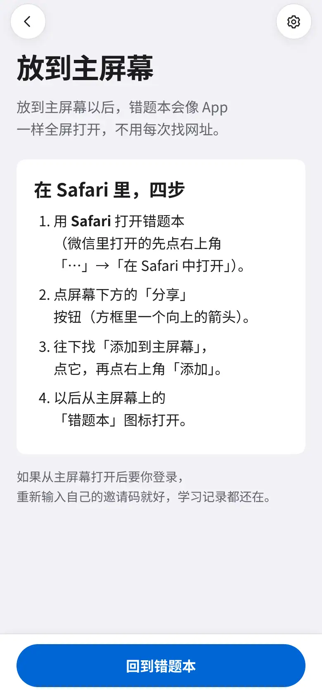

### 安卓（小米、红米浏览器和 Chrome）

1. 用自带浏览器或 Chrome 打开 `/s/` 并登录。
2. 自带浏览器：菜单 →「添加到桌面」。Chrome：右上角「⋮」→「添加到主屏幕」；如果写成「安装应用」，点它也行。
3. 图标名是「错题本」。安卓上的清单故意用浏览器方式打开（manifest 的 display 是 browser），桌面图标会进浏览器标签，不会变成一个单独的全屏壳。这样点相册和拍照时，系统选择器才能弹出来。如果某个桌面壳打不开相册，改用 Chrome 或系统浏览器打开学习页，再添加一次。

下面是菜单长什么样的示意图，不是真机截图。小米、红米浏览器和 Chrome 的菜单位置不一样，字也可能是「添加到桌面」或「安装应用」里的一种。

### iPhone（Safari）

1. 必须用 Safari。微信里先点右上角「…」→「在 Safari 中打开」。
2. 点屏幕下方的「分享」（方框里一个向上的箭头）。
3. 往下找「添加到主屏幕」，点它，再点右上角「添加」。图标名是「错题本」。
4. iPhone 上清单是独立应用方式（display 为 standalone）。从主屏幕打开是全屏。如果又要你登录，输入自己的邀请码，学习记录都在。

清单地址是 `/s/manifest.webmanifest`。Service Worker 只缓存页面外壳，不缓存错题和照片。

## 注册与登录

1. **注册。** 打开 `/s/register`，填姓名和手机号，自己设一个 4 位数字找回码（不要用 1234、0000 这种）。老师给了班级注册码的，页面上会出现这一格，一并填上；没给就没有这一格。不用密码，也不发短信。姓名可以写化名，手机号可以填家长的。
2. **保存邀请码。** 注册成功后显示 12 位邀请码，只在这一页完整显示一次。截图或复制，不要发给别人。邀请码 60 天内可以反复登录。
3. **选学段。** 第一次进入会问初中还是高中。以后可以在设置里改。
4. **登录。** 打开 `/s/`，输入邀请码。短横线、空格、大小写都不用管。登录后常用的话不用每次输。
5. **查看或换邀请码。** 「设置 → 我的邀请码」里可以查看、复制，或重新生成。重新生成后旧码和其他设备的登录会失效，学习记录都在。快到期时设置页会提醒你换码。

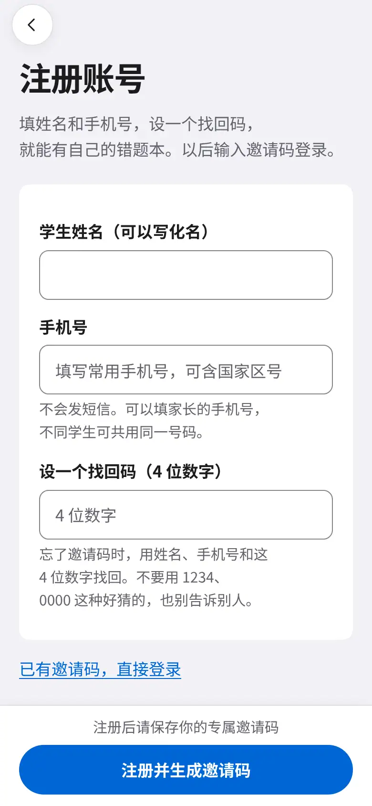

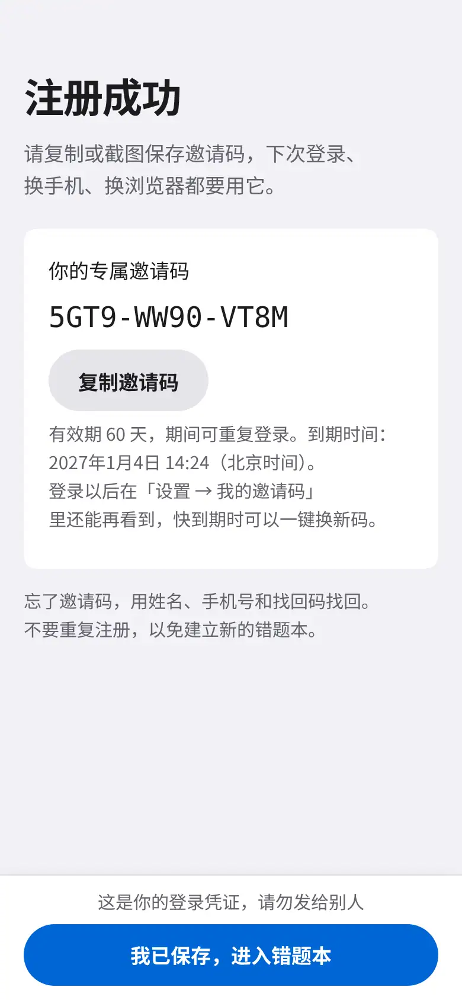

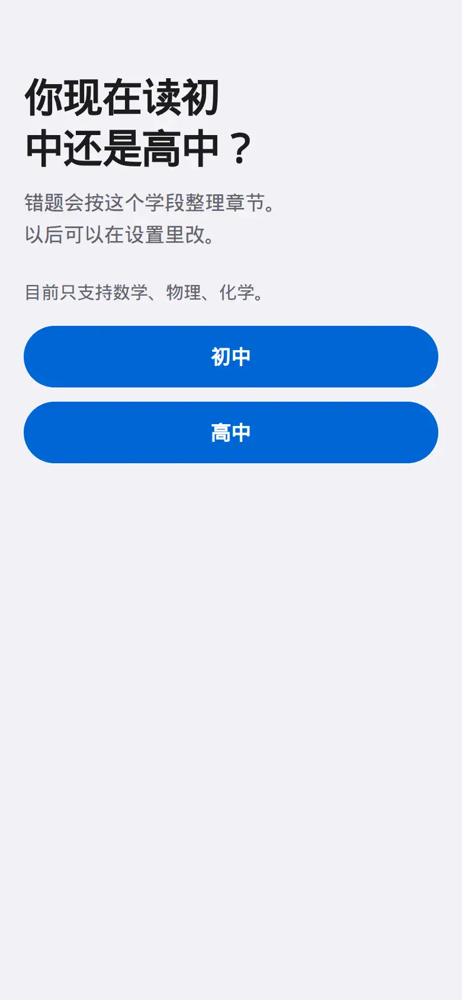

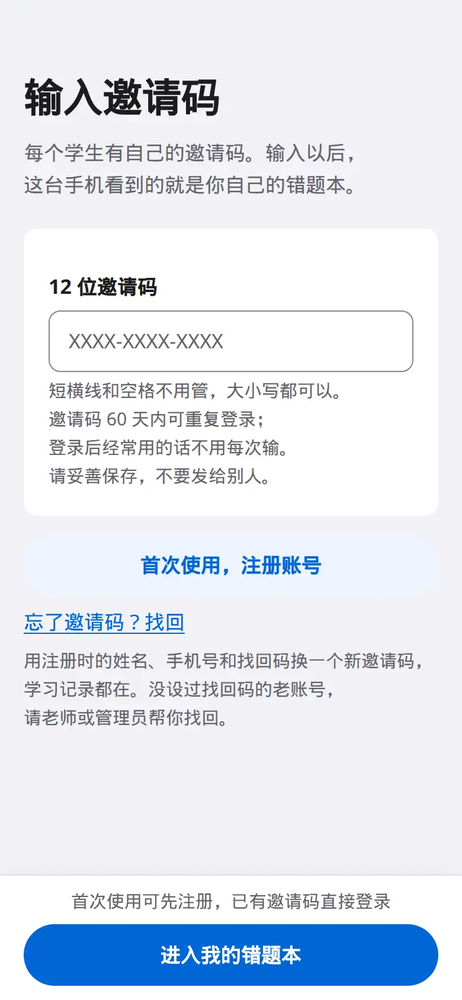

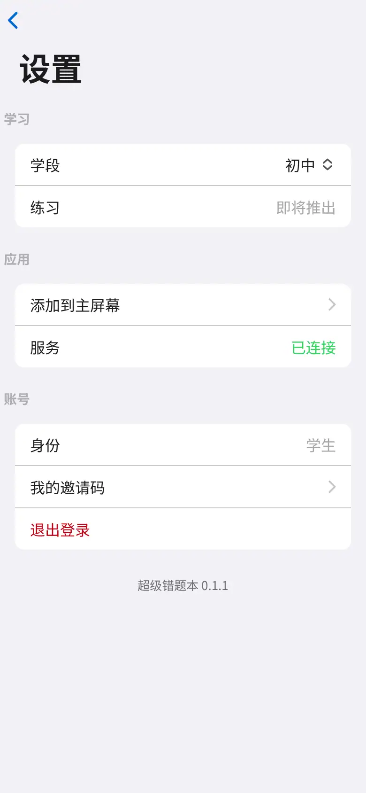

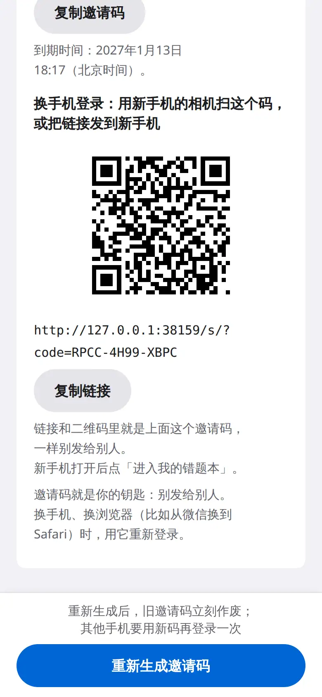

忘了邀请码：打开 `/s/recover`，用注册时的姓名、手机号和找回码换一个新码，记录都在，旧码作废。没设过找回码，或找回码也忘了，找老师重发。

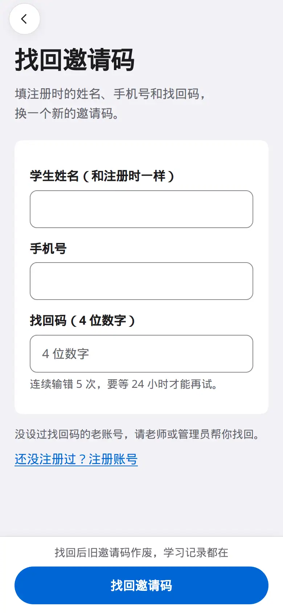

## 怎么拍照

错题本右下角有两个圆钮：上面是拍照，下面是相册。还没有错题时，中间也有「去拍照」和「从相册选择」。录入页底部同样有拍照和相册。浏览错题时这些入口旁边不放「单页 / 多页」。

点拍照或相册之后，再选这一次是单页还是多页（点哪一项，就由这一下打开相机或相册）：

- **单页：** 拍一张或从相册选图后立刻上传，进入「录入」。相册仍可一次选多张，每张按单独一页处理。
- **多页：** 适合一套卷子有好几页。每拍一张先留在本页的预览条里，可标「试卷」或「答题卡」，可删掉某一张；点「完成」后整组一起上传。一次最多 8 页。点「放弃这组」会清空还没传的预览。这组还在的时候，预览旁边可以改「单页 / 多页」。改成单页后，拍照和相册先停用，要点「完成」或「放弃这组」才能再拍。

拍题目、你的作答、老师的批改和答案页都可以。放平、拍全、光线均匀。小米、红米手机点相册圆钮或「从相册选择」，再点「单页」或「多页」，即可选图。

选好后进入「录入」。照片在后台上传，AI 在找题。同一张图只保存一次。录入页还可以按上传日筛选，只看某一天传的材料。录入页空着的时候也不常驻「单页 / 多页」，点拍照或相册后再选。

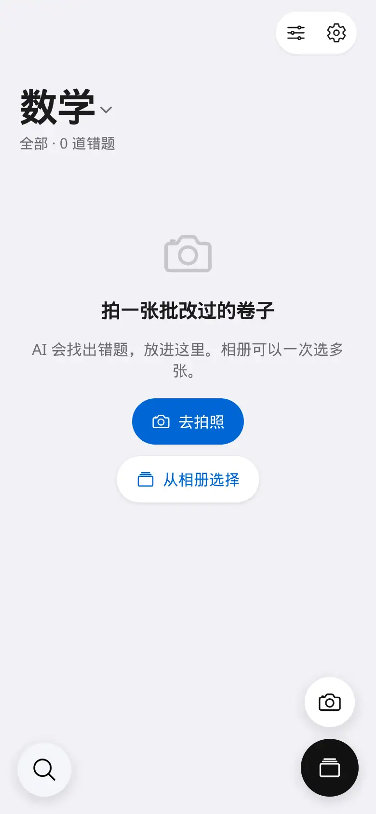

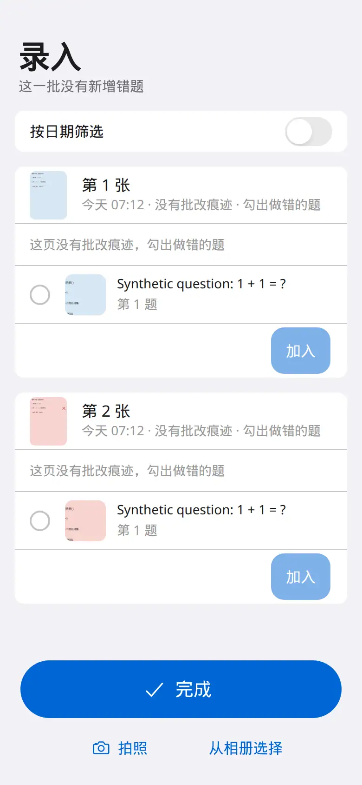

## 怎么选错题

1. 老师打了叉、或能看出批改痕迹的题，会自动收进错题本。不相关的，在那一行上左滑，点「删除」。
2. 这页没有批改痕迹时，勾出做错或没把握的题，再点「加入 N 道」。做对的不用勾。
3. 在错题本点进题目。详情最上面是整张原图，点开可以放大。
4. 字认错了，点「识别错了？改」，或右上角「…」→「改题目文字」。以照片为准。
5. 不是错题：右上角「…」→「不是错题，移除」。
6. 详情往下还有你写的、批改痕迹、章节与知识点、正确答案（可以拍照录入答案）和错因备注（可以打字，也可以按一下说）。AI 的答案和解题过程仅供参考。

错题本右上角可以按章节、知识点筛选，也可以切换网格和列表。左下角可以搜索。

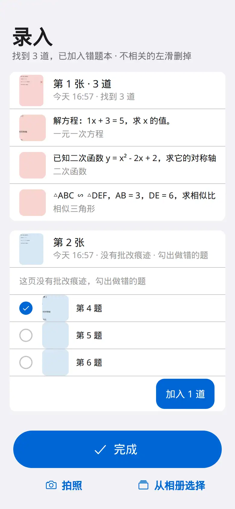

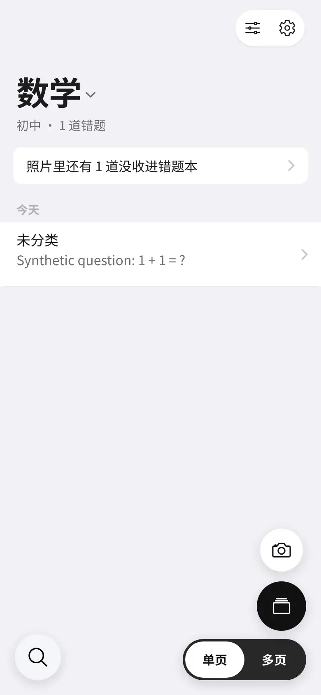

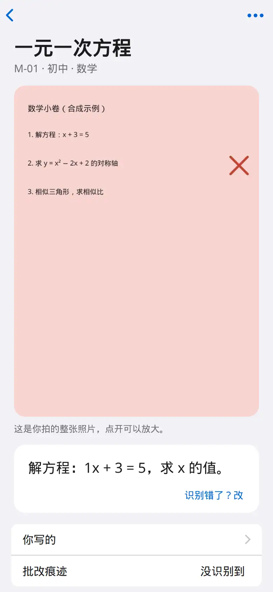

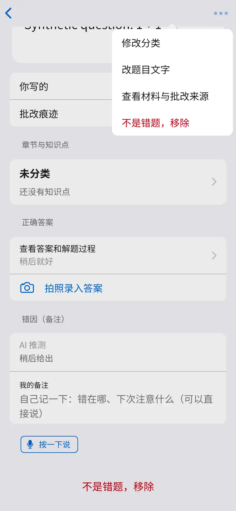

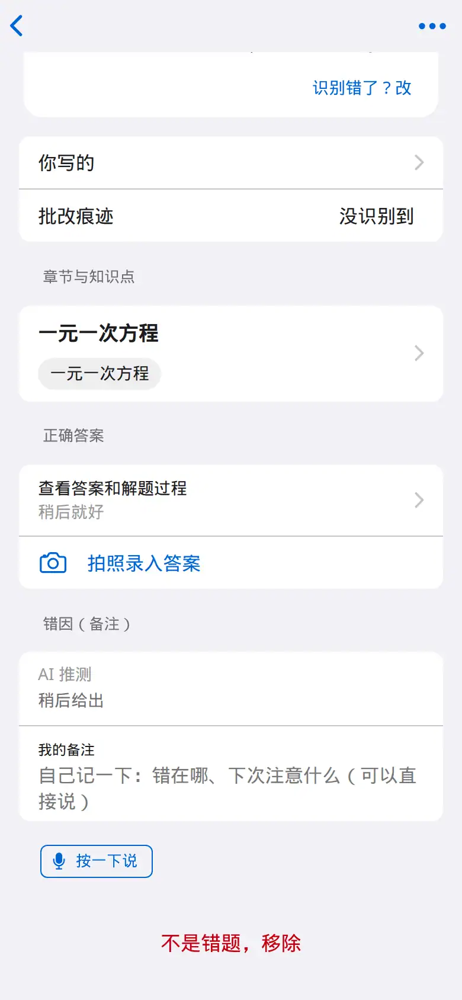

## 练习

设置里的「练习」一行写着「即将推出」。当前学生端没有练习入口，也不提供打印练习、纸上记结果或拍照交练习。旧地址若还能打开，不属于这一轮的使用说明。

## 常见问题

**换手机？** 用同一个邀请码在新手机登录，学习记录都在。

**忘了邀请码？** 打开 `/s/recover`，用姓名、手机号和找回码换一个新码。找不到就让老师重发，旧码作废。

**打不开相册？** 安卓桌面图标如果进了一个没有文件选择器的壳，点相册没反应。改用 Chrome 或系统浏览器打开 `/s/` 再拍。小米、红米请点页面上的相册入口。

**AI 认错字？** 题目详情 →「识别错了？改」，或「…」→「改题目文字」。以照片为准。

**不是错题？** 「…」→「不是错题，移除」。录入页可以左滑删除。

**拍了两张一样的？** 同一张图只保存一次。

**在微信里打开？** 可以先看。添加到桌面和选相册时，点右上角「…」，换到系统浏览器或 Safari，再用邀请码登录一次。
