# 学生使用说明

第一次用，按这三步：自己打开注册页，填好姓名、手机号和找回码；把邀请码保存下来；再拍一张批改过的卷子。做错的题就收进错题本。

家长只看到完成情况和掌握程度这些汇总，看不到题目，也看不到错因。目前支持数学、物理、化学。

说明页配图里的题目来自真实试卷，已隐去姓名、学校、手机号和邀请码。添加到主屏幕的确认页和主屏幕图标是 iPhone 实拍。

## 第一次用

1. **注册。** 打开 `/s/register`，填写 Name、手机号和找回码。页面上写着「找回码跟手机号仅用于找回账户」。已经有邀请码的，点「已有邀请码，直接登录」。

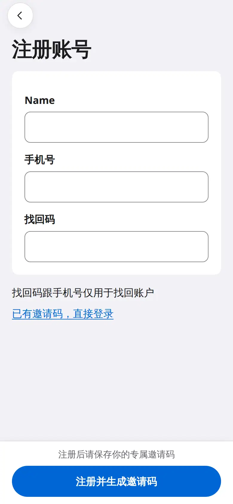

2. **保存邀请码。** 注册成功后显示 12 位邀请码，只在这一页完整显示一次。截图或复制，不要发给别人。邀请码 60 天内可以反复登录。图里的邀请码已隐去。

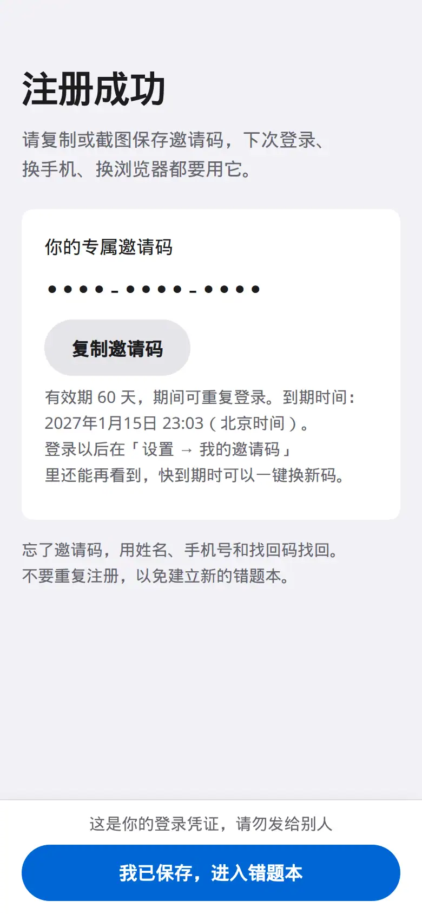

3. **拍卷子。** 点「新增」。一张纸用「单页」。试卷和答题卡不在同一页，用「多页」。再点「开始」。放平、拍全、光线均匀。

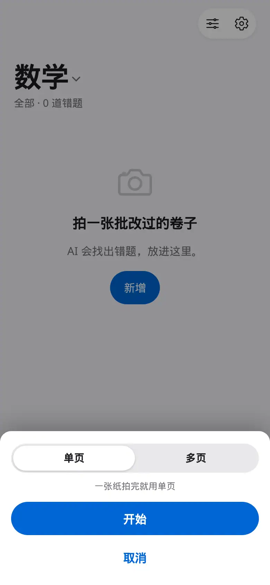

4. **收进错题本。** 老师打了叉、或能看出批改痕迹的题，会自动收进来。这页看不出批改痕迹时，勾出做错的题，再点「加入」。认出来的字如果和照片不一样，以照片为准。

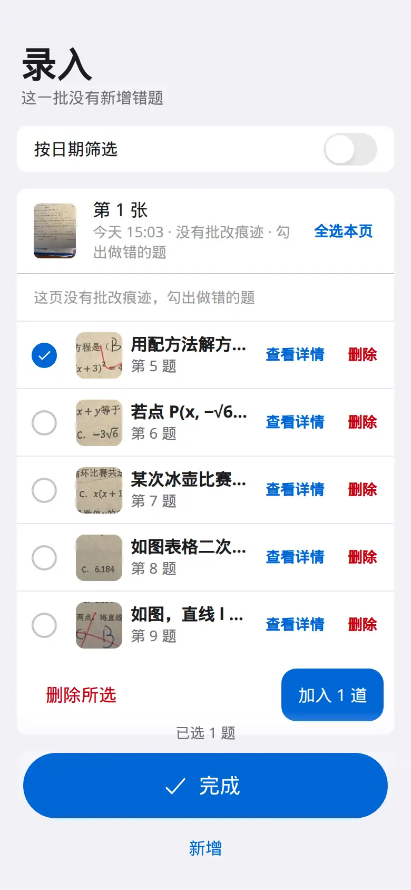

第一次进入会问初中还是高中。选好以后，错题按这个学段整理。

## 经常用

收进来的题在错题本里，按章节和知识点排好。点进一道题，最上面是整张原图。字认错了，点「识别错了？改」，以照片为准。右上角「…」可以改题目文字，或点「不是错题，移除」。正确答案和解题过程标着「仅供参考」。

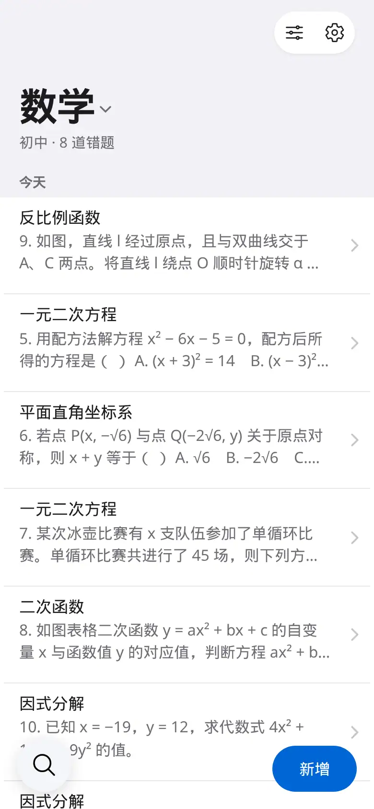

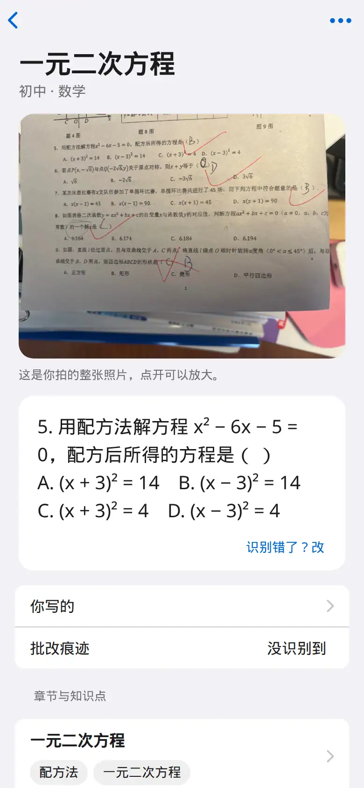

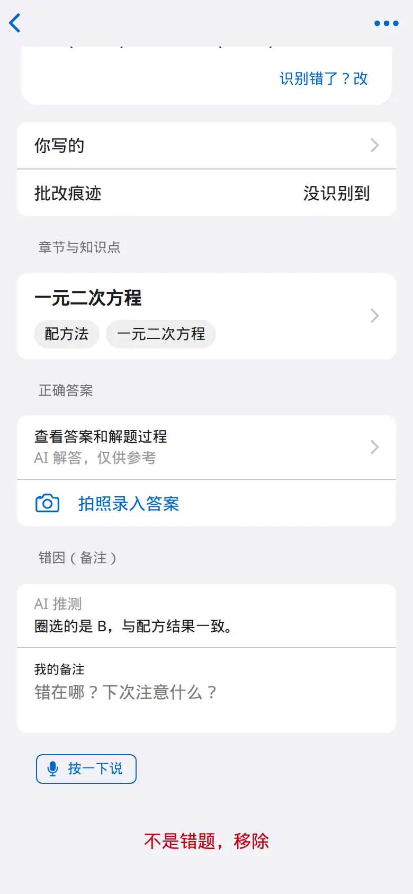

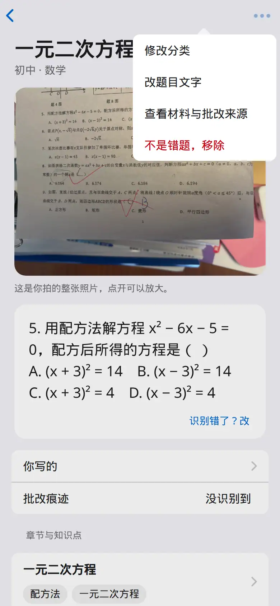

已经有邀请码的，打开 `/s/`，输入邀请码，点「进入我的错题本」。短横线、空格、大小写都不用管。

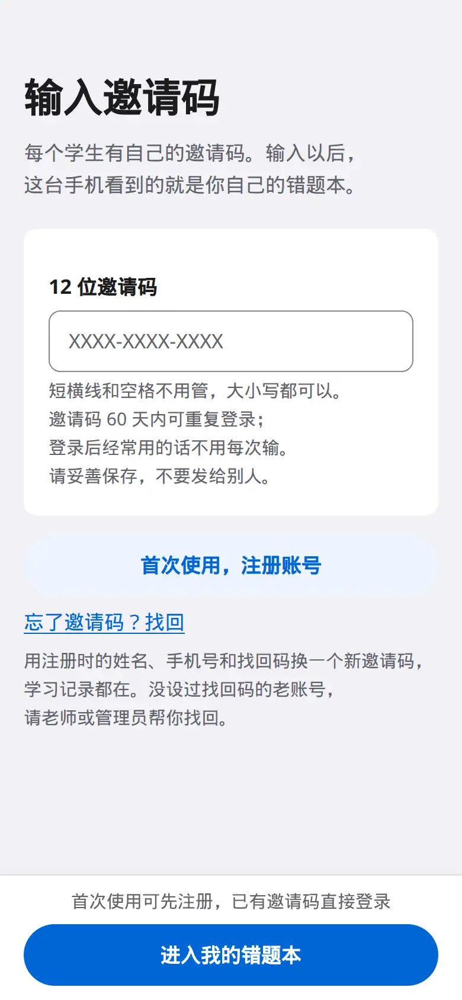

### 添加到手机桌面

错题本是网页，可以放到手机桌面上。请用系统浏览器打开，不要在微信里添加。微信里先点右上角「…」，选「在浏览器打开」或「在 Safari 中打开」。

**iPhone（Safari）**

1. 用 Safari 打开学习页。
2. 点屏幕下方的「分享」（方框里一个向上的箭头）。
3. 往下找「添加到主屏幕」，点它，再点右上角「添加」。
4. 以后从主屏幕上的「超级错题本」打开。

确认页上名称是「超级错题本」，地址是学习页。「作为网页 App 打开」保持打开。

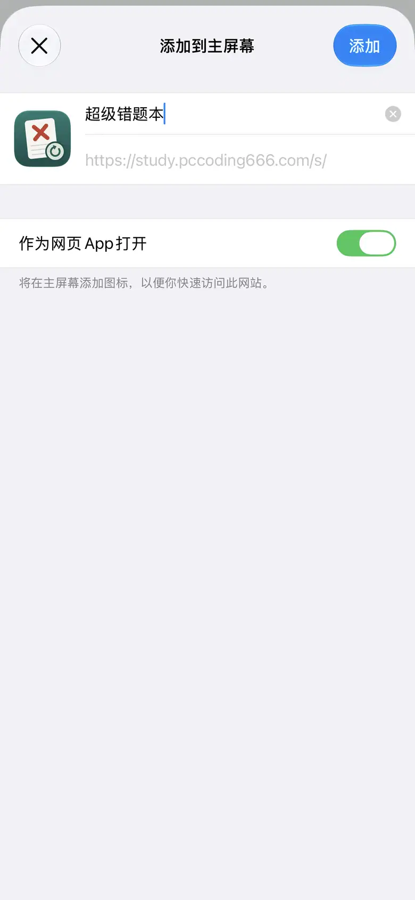

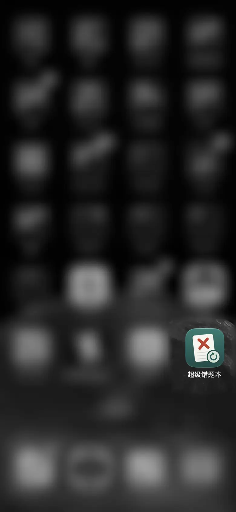

**安卓（Chrome 或系统浏览器）**

用 Chrome 或系统浏览器打开学习页并登录。菜单里点「添加到桌面」或「安装应用」。桌面图标会打开浏览器页面，这样拍照和从相册选图才能用。

## 遇到问题

**换手机？** 「设置 → 我的邀请码」里的登录链接和二维码，是给学生在新手机上再用自己的码，不是开学的第一步。扫一下或输入同一个码。打开链接以后，要点「进入我的错题本」才算登录。学习记录都在。

**忘了邀请码？** 打开 `/s/recover`，用姓名、手机号和找回码换一个新码。找不到就找老师。

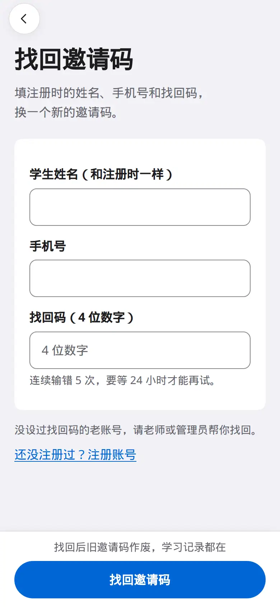

**打不开相册？** 安卓桌面图标如果进了一个没有文件选择器的壳，点相册没反应。改用 Chrome 或系统浏览器打开 `/s/` 再拍。

**识别错了？** 题目详情 →「识别错了？改」，或「…」→「改题目文字」。以照片为准。

**不是错题？** 「…」→「不是错题，移除」。录入页可以左滑删除。

**拍了两张一样的？** 同一张图只保存一次。

**在微信里打开？** 可以先看。添加到桌面和选相册时，点右上角「…」，换到系统浏览器或 Safari。登录页上有「复制网址」。

## 联系

使用中有问题，先问老师。也可以加入微信群「超级错题本天使用户」。入群二维码在 2026 年 11 月 23 日前有效。

