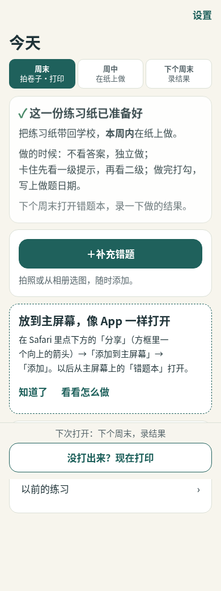
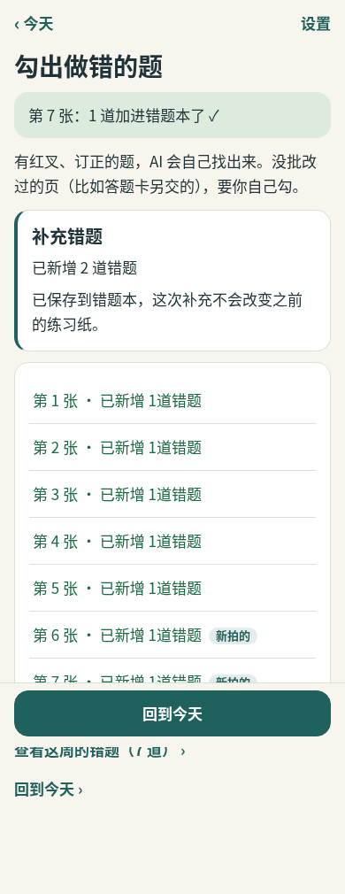

# 生成练习纸后继续补充错题

本轮修复基于 `411017f`，保留主线的局部轮询、身份标签和相册多选上传。

## 修改

- 首页状态卡片下方常驻“＋补充错题”，入口不随整理、练习生成、周中等待或等待录结果而消失。
- 完成标题改为“这一份练习纸已准备好”。继续使用现有拍照、识别和勾选流程。
- 上传与识别中提示“照片已收到，正在找题。”；实际入库后才报告新增数量，包括勾选后的提示。拍照页的等待提示随局部轮询正确移除。
- 提供本周错题、返回今天及原练习纸不变的提示。不修改选题、掌握或登录权限规则。

## 实际验证

全部使用本地合成数据和 mock provider，不使用真实学生资料。

- `npm run verify` 的类型检查、构建和 Vitest 阶段通过：804 通过、5 个既有环境条件跳过。
- 更正旧浏览器夹具重复照片后，最终 `npm run test:e2e`：35 通过、6 个环境/可选证据用例跳过。
- 单元测试覆盖首页各状态入口；集成测试覆盖自动识别和手动勾选两条 5+2 路径，核对原练习、题号、打印快照及已有做题记录不变。
- 邀请码浏览器流程覆盖生成 5 道练习、从首页新增 2 道、查看 7 道错题、刷新、退出再登录、重新打印及只录入原来 5 道结果。
- 等待页浏览器夹具使用不同照片，避免重复上传的识别数量掩盖实际未入库。重新登录前后对比纸张时只排除会话轮换的 `sel-voice-context` 元信息，纸张内容仍完整比较。
- 合并前独立代码审查完成，无遗留重要问题。

## 截图

