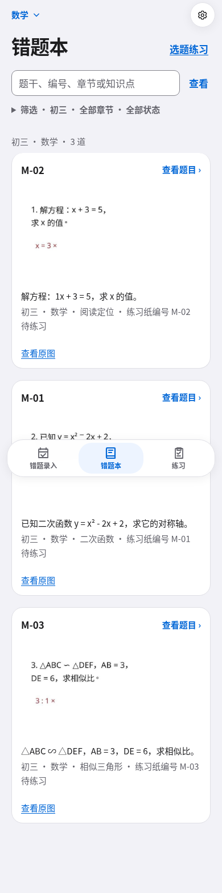
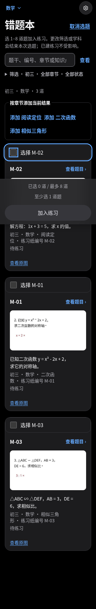

# 错题本阅读与显式选题验收（2026-10-19）

## 目的与范围

默认直接展示错题，找题、阅读、进入详情；年级/学科/章节/学习状态与搜索共同筛选；搜索直接可用，低频筛选收进原生展开控件。只有点“选题练习”后才出现选择控件。设计与两份 PR 的边界见 [已确认设计](../superpowers/specs/2026-10-19-notebook-reading-detail-design.md)。

本 PR 只负责阅读列表、筛选、选择、详情返回上下文；单题详情的学习操作与真实作答/提示记录由独立 PR 负责。保留 SSR、原有练习服务/资格/最多八题及延迟掌握规则，无新增生产依赖、数据结构或框架。详情的唯一改动是可选 `returnTo` 与返回链接。

## 每个可见元素的 HIG 对照

这是 Apple HIG 原则在网页上的适配，不是 Apple 认证。44×44 指 CSS px，不将它等同于原生 pt。

| 元素 | HIG 原则与具体实现 | 检查证据 |
| --- | --- | --- |
| 错题本标题、年级/学科/结果数 | [Layout](https://developer.apple.com/design/human-interface-guidelines/layout)、[Typography](https://developer.apple.com/design/human-interface-guidelines/typography)：单一标题、系统字体、相对字号；结果/总数明确范围 | 浏览器读取标题与计数；移动和桌面、200% 字号截图 |
| 顶部学科切换、设置 | [Navigation and search](https://developer.apple.com/design/human-interface-guidelines/searching)、[Buttons](https://developer.apple.com/design/human-interface-guidelines/buttons)：复用原生 details 学科菜单和既有设置入口，有当前学科；切换保留有效年级 | 原有 webHig.spec.ts 菜单行为；本次有/无脚本返回后学科/年级检查 |
| “筛选”原生展开、年级、章节、学习状态 | [Accessibility](https://developer.apple.com/design/human-interface-guidelines/accessibility)：默认收起的原生 details 摘要显示当前范围，原生 select、明确 label/for/id；章节包括“未分类”；只筛选，不自动创建练习 | 浏览器按精确标签操作三个选择器；320px/200% 不横溢；目标尺寸和键盘焦点检查 |
| 搜索输入与“查看” | [Searching](https://developer.apple.com/design/human-interface-guidelines/searching)：说明题干、编号、章节、知识点范围；GET 查询可分享；检索完整题干证据与短文本，未声称搜索笔记 | 单测大小写/编号/章节/标签和完整题干；集成测试联合筛选；浏览器联合搜索再进入详情返回 |
| “清除筛选” | [Searching](https://developer.apple.com/design/human-interface-guidelines/searching)：可恢复到当前年级和学科全部题目，操作文字直接 | 浏览器无结果后清除恢复三道；有/无脚本 |
| 平铺题目卡、编号、识别短文本、分类、学习状态 | [Hierarchy](https://developer.apple.com/design/human-interface-guidelines/layout)：题目直接可见，不需先展开章节；状态用文字，OCR 警告留到详情；不推断新错因或掌握状态 | 集成测试浏览没有 checkbox/章节 details；历史照片全移到 2025 年仍读到；浏览器首张在视口内且 390px 宽时卡片顶部小于 320px；卡片左右内边距 16px |
| 整题照片与“查看原图” | [Images](https://developer.apple.com/design/human-interface-guidelines/images)、[Dark Mode](https://developer.apple.com/design/human-interface-guidelines/dark-mode)：`scope=full&s=big`、按比例显示，无固定高度裁剪、无暗色滤镜；短文本与原图链接始终保留 | 浏览器照片加载、自然/渲染比例和高度检查；使用合成中文方程照片截图；主动阻断图片请求后文字/原图入口仍可用 |
| 卡片进入详情、详情返回、底部三个导航 | [Navigation](https://developer.apple.com/design/human-interface-guidelines/navigation-and-search)：站内规范 `/s/items`，白名单 grade/subject/chapter/status/q 与 item anchor；原生返回可无脚本使用 | URL 单测拒绝外站/任意路径/未知参数/非法锚点；浏览器详情返回和浏览器后退保留筛选与位置 |
| “选题练习”、“取消选题”与范围说明 | [Buttons](https://developer.apple.com/design/human-interface-guidelines/buttons)、[Feedback](https://developer.apple.com/design/human-interface-guidelines/feedback)：显式进入/退出模式；说明筛选/学科变化结束本次选择；筛选表单与创建表单分开 | 浏览器选择后提交筛选回到浏览、再次进入零选择；取消按钮尺寸检查 |
| 单题复选框与不可选状态 | [Accessibility](https://developer.apple.com/design/human-interface-guidelines/accessibility)：原生 label 包裹 checkbox，点击整行；未选且无资格的题禁用并说明；资格变化后已选题保持可取消 | 浏览器 JS 开/关逐题取消；复选行尺寸/键盘焦点；集成 stale 409 保留确切 ID、无练习创建 |
| “添加 [章节]”分组按钮 | [Buttons](https://developer.apple.com/design/human-interface-guidelines/buttons)：只添加当前结果中该章可练习的题，不创建练习；跨章可添加，单题可取消 | 集成搜索条件 1x 只选一题；浏览器连续添加两章得到九题；无脚本相同流程 |
| 已选数量、上限提示 | [Feedback](https://developer.apple.com/design/human-interface-guidelines/feedback)：固定操作栏文字 `已选 n 道 / 最多 8 道` 是唯一 polite、atomic 实时状态；创建按钮通过 aria-describedby 关联计数与恢复说明；超过时说明恢复；脚本只更新计数，不取消第九个选择；无脚本提交后服务器更新 | 有脚本即时 9→8，0/9 禁用创建、8 启用；无脚本超过八题错误仍九个选中；不依赖颜色；浏览器后退恢复勾选/计数/可提交状态 |
| “加入练习”与无脚本说明 | [Buttons](https://developer.apple.com/design/human-interface-guidelines/buttons)：唯一创建动作，复用既有固定 NextBar，以选题数/上限和恢复提示替换底部导航；服务端原样校验 ID、重复、资格及 1–8 上限 | 精确选一题只创建一题练习；0/9/错误 ID/资格变化都失败并保留选择；320px/200% 创建按钮持续可达，最后原图入口可滚到操作栏上方，不与导航叠加 |
| 无结果、尚无错题、仍在找题 | [Feedback](https://developer.apple.com/design/human-interface-guidelines/feedback)：区分空库/无匹配；明确旧题/未分类也收录；恢复全部题目/查看照片/录入入口 | 集成历史和未分类过滤；浏览器无匹配恢复；既有等待和空学科检查 |
| 错误提示、保留的选择、移除撤销 | [Feedback](https://developer.apple.com/design/human-interface-guidelines/feedback)：复用 role=alert/status；不可用/移出筛选的已选题仍可明确取消，不暗中排除 | 集成 invalid/stale/超过八题保留；既有移除/撤销集成测试继续通过 |
| 浅/深配色、文字、边界、焦点与动效 | [Color](https://developer.apple.com/design/human-interface-guidelines/color)、[Accessibility](https://developer.apple.com/design/human-interface-guidelines/accessibility)：复用语义色、系统字体/相对字号和已有 focus-visible；复选状态不只颜色；照片保持原色；无新动效 | 浅/深、320/390/1200px、200% 字号的真实浏览器布局与目标检查；正常文字颜色对比计算，见下方 |

## 服务端与渐进增强约束

- 完整题库从 `getWeek(..., true)` 取得，包含历史已练习/掌握题，排除移除题。`anyPhoto` 只控制空态入口，不控制旧题可见性。
- 搜索使用完整题干证据、短文本、编号、章节、知识点；不搜索或暗示搜索未提供的学生反思。
- `recommendPractice` 提供可练习集合；`createPractice` 为最终权威，检查原样 ID。网页不截断九题，不静默去掉过期资格。
- 章节按钮是原生 POST 提交，无脚本仍能添加并保留逐题调整。GET 筛选与 POST 创建不同表单，不会因筛选而提交练习。
- 返回目标只允许原始 `/s/items` 路径、白名单查询与合法 item anchor，不接受 URL 规范化后碰巧落入该路径的任意路径/外站。
- 新增会话 cookie `sel_items_grade` 仅保存有效年级，`Path=/s; HttpOnly; SameSite=Lax`；与学科 cookie 同为会话有效，生产 Secure；隐私文档同步。

## 验证记录

- 首轮 RED：四项新增集成测试均因功能缺失失败：默认复选框、旧章节选择、缺少逐题/精确校验恢复、丢失返回上下文。
- 白名单补充 RED/GREEN：`status=toString` 被对象原型误判为有效，新增测试失败后改为 `Object.hasOwn`，12 个 helper 测试通过。
- 紧凑筛选/固定选题栏 RED/GREEN：两项新增 SSR 断言先失败；实现默认收起筛选、任务操作栏后，两项通过。
- 聚焦 helper + webClient 集成：61 通过；首轮全量 Vitest 870 通过/5 项既有跳过。
- 最终紧凑布局的 Chromium 选题专项：4 通过（JS 开/关各两例，26.5 秒；含最终按钮资格增强）。按精确标签操作，真实键盘焦点，照片完整比例，组合筛选，返回/后退，零题/九题恢复，0/9 脚本禁用与 8 启用、后退恢复，所有新控件目标尺寸，浅/深色 320/390/1200px 与 200% 字号，图片失败，最终内容不遮挡均检查。
- 创建按钮增强 RED/GREEN：新增浏览器断言先发现九题时仍可点；改为仅脚本禁用 0/超过 8 题，保留无脚本服务器校验。最终选题专项四项通过。
- 基础实现 `b928557` 的完整 `npm run verify`：退出码 0。typecheck / build 通过；Vitest **73 个文件通过、870 通过 / 5 项既有跳过**；Playwright **46 通过 / 6 项既有跳过**（3.4 分钟）。Vitest 跳过为 macOS sips/HEIC 三项和无 Caddy 的两项；浏览器跳过为 macOS WebKit/HEIC 一项及五项按需证据包测试，均与基线相同。没有未解决测试失败。

复审补充：计数原为普通段落，而实时区域只更新通用提示。两个新增浏览器断言先因缺少 `role=status` 失败；改为仅错题本选题启用的 `aria-live=polite` / `aria-atomic=true` 计数区域，恢复提示不再单独广播。脚本仅在文本变化时写 DOM，重复 change/pageshow 不触发相同计数的 DOM 更新。针对性 typecheck 通过，helper/浏览器生命周期/网页路由集成共 **83 项通过**，错题本 Chromium **4 项通过**（33.2 秒）；真实 accessible description 补充检查在 JS 开/关 **2 项通过**（19.0 秒）。此次按复审范围仅跑覆盖检查，未重跑完整 verify。浏览器自动断言证明 ARIA 关系与更新机制，未验证真人 VoiceOver 播报时机。

状态文案同时纠正：首次延迟独立做对即可进入 temporarily_mastered，因此显示“已延迟做对”；stably_mastered 显示“已多次延迟做对”。未改状态机或延迟规则。

对比度按 WCAG 相对亮度公式对实际复用 CSS 语义色计算：浅色正文/页面 15.25:1，次要文字/页面 5.33:1，交互/页面 4.86:1，按钮前景/背景 5.42:1；深色分别为 19.29:1、9.52:1、8.74:1、7.05:1。输入边界/卡片浅色 3.66:1，深色 5.10:1。上述正文均超过 4.5:1，边界超过 3:1。这是所使用颜色配对的计算，不声称完整 WCAG 审计。

截图由 `tests/e2e/zzCategories.spec.ts` 自动写入 `test-results/zzCategories-章节选题（脚本开启或关闭）-阅读、联合搜索、返回定位与选题恢复在浅深色和大字下可用/`：`reading-light.png`、`reading-dark.png`、`reading-light-desktop.png`、`reading-dark-desktop.png`、`reading-dark-320-200.png`、`selection-dark.png`。照片为代码生成的合成方程练习纸，没有用户照片。

## 可审查的合成截图

以下为最终渐进增强版本；照片由测试代码生成，只有合成中文方程和批改记号。

## 人工验证的边界

以上为本地 Linux Chromium 自动检查与合成图片的人工截图审查。没有真实学生数据、没有真实 iPhone/Safari/VoiceOver、没有实际打印；不将这些浏览器检查称为真人读屏或真机验收。照片实际清晰度仍取决于上传原图，学生可进入详情/原图放大。没有上线、合并或改动生产数据。

## 与单题学习 PR2 的最终组合

独立阅读分支 `e88f1b5` 已合入 PR2 分支，以保留已解决冲突且可完整验证的列表/详情组合。两份 PR 仍目标 main，PR2 显式依赖 [PR #34](https://github.com/PCcoding666/Super_Error_Log/pull/34)，按 #34→PR2 顺序；没有合并 main 或部署。返回白名单统一复用本 PR 的 `safeNotebookReturn` / `notebookUrl`，详情薄封装仅补充题目锚点。联合筛选→新学习详情→返回与过期单题 POST 的真实上下文均有集成覆盖；完整组合门禁在集成提交后执行，结果同步在[详情验收](2026-10-19-notebook-detail.md)。
